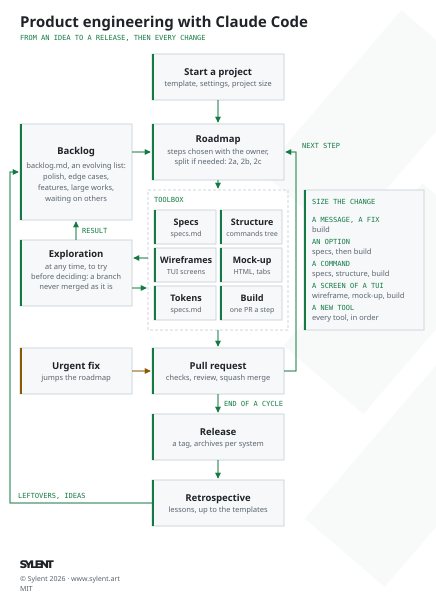

# rust-cli-template

Template for Rust command-line applications, with the project conventions, the process from an idea to a release, and the Claude Code setup. Formerly `rust-project-template`; its web counterpart is [astro-static-website-template](https://github.com/aunimhsn/astro-static-website-template).



## What it contains

| File | Content |
|---|---|
| `process.md`, `docs/process.svg`, `docs/process-light.svg` | How an application goes from an idea to a release and keeps growing: a toolbox (specifications, structure, wireframes, mock-up and design system for a terminal interface, build, release, retrospective) picked for each change, a backlog and a roadmap, the urgent fixes and the explorations, with its diagram, dark and light (the README and `process.md` show the light one). |
| `design-journal.md` | The design experiences of past applications: choices kept and rejected, and why. A source of ideas, not rules. |
| `CLAUDE.md` | Rules for Claude Code: communication, naming, language, specifications and roadmap, Git workflow, commit messages, code review, checks, releases. |
| `.claude/agents/code-reviewer.md` | Subagent that reviews a branch before its pull request and writes its notes, in French, to `outputs/`. |
| `.claude/agents/dependency-reviewer.md` | Subagent that reviews the open Dependabot pull requests and tells, in French, which to merge or set aside, with their links and the comments to post. |
| `.claude/skills/excalidraw-wireframes/` | Skill: editable Excalidraw wireframes of a terminal interface, and sketches of a structure (the commands and their options), iterated with the owner (Python helpers and an SVG preview). |
| `.claude/skills/html-mockups/` | Skill: the HTML mock-up built from the wireframe, styles and open decisions compared with tabs, then the design tokens (starting page, server without cache, headless screenshots). |
| `specs.md` | Skeleton of the specifications: what the application does. |
| `roadmap.md`, `backlog.md` | Skeletons of the roadmap (the size of the project and the steps chosen, one pull request per step, kept short since it is read at every session) and of the backlog (polish, edge cases, features, large works, waiting on others). |
| `docs/technical-choices.md` | The technical choices and their reasons. |
| `.claude/settings.json` | Project settings of Claude Code: the claude.ai connectors turned off and the unused skills hidden from the model, to save tokens. |
| `Cargo.toml` | Package, `unsafe` code forbidden, Clippy pedantic lints, optimized release profile. |
| `rust-toolchain.toml` | Stable toolchain with `rustfmt` and Clippy. |
| `.github/workflows/ci.yml` | Format, lint and test on every pull request, and build with the minimum Rust version (`rust-version`). |
| `.github/workflows/release.yml` | Windows, macOS and Linux archives published as a GitHub release on version tags. |
| `.github/dependabot.yml` | Weekly pull requests to update the crates and the GitHub Actions. |
| `LICENSE-MIT`, `LICENSE-APACHE` | Dual license, the Rust ecosystem default. |
| `inputs/`, `outputs/` | Untracked working folders: temporary references given to Claude Code, and temporary files it produces (see `CLAUDE.md`). |

## Start a new project

1. Create the repository from this template, with the **Use this template** button or:

   ```sh
   gh repo create <name> --template aunimhsn/rust-cli-template --private --clone
   ```

2. In `Cargo.toml`, update `name`, `description` and `repository` (add `keywords` and `categories` if the crate is published), then run `cargo build` to update `Cargo.lock`.
3. Adapt this README to the project: keep the Requirements, Build, Development, Release and License sections, replace the others.
4. Check the license: keep `MIT OR Apache-2.0`, or change `license` in `Cargo.toml` and the `LICENSE-*` files (they are also copied into the release archives by `.github/workflows/release.yml`).
5. On GitHub, protect `main` (**Settings › Rules › Rulesets**): require a pull request and the `Format, lint and test` and `Minimum Rust version` checks. On a free account, rulesets only apply to public repositories.
6. Set the pull request settings, which are not copied from the template: allow only squash merging, and delete the branches once merged (**Settings › General › Pull Requests**), or:

   ```sh
   gh repo edit --enable-squash-merge --enable-merge-commit=false --enable-rebase-merge=false --delete-branch-on-merge
   ```

7. With Claude Code, follow [process.md](process.md): size the project, write `specs.md`, then split it into steps in `roadmap.md`, and confirm the choices of `docs/technical-choices.md`.

## Requirements

- Rust 1.93 or later (stable toolchain, see `rust-toolchain.toml`)

## Build

```sh
cargo build --release
```

## Development

```sh
cargo fmt --all
cargo clippy --all-targets --all-features -- -D warnings
cargo test --all-features
```

## Release

1. Update `version` in `Cargo.toml` (then run `cargo build` to update `Cargo.lock`) and merge it into `main`.
2. Tag the merged commit with the same version and push the tag:

   ```sh
   git switch main && git pull
   git tag v0.1.0
   git push origin v0.1.0
   ```

The [Release workflow](.github/workflows/release.yml) builds the archives for Windows, macOS and Linux and publishes them as a GitHub release. It fails if the tag does not match the version of `Cargo.toml`.

## License

Licensed under either of

- Apache License, Version 2.0 ([LICENSE-APACHE](LICENSE-APACHE))
- MIT license ([LICENSE-MIT](LICENSE-MIT))

at your option.
