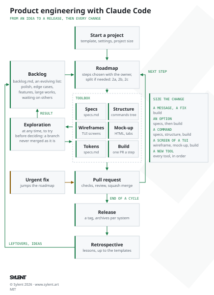

# Process

How a command-line application goes from an idea to a release, then keeps growing, with Claude Code. Its web counterpart is [astro-static-website-template](https://github.com/aunimhsn/astro-static-website-template/blob/main/process.md): a lesson that applies to every project goes to both.

The process is not a straight line. Its phases are **tools**, picked for each change according to what it needs: a new option goes straight to the build, a new screen of a terminal interface goes through its wireframe and mock-up first. What is not being done lives in a **backlog**; what is chosen goes to the **roadmap**, one pull request per step. Each tool ends with something the owner validates, from the cheapest to the most expensive: changing a sentence in the specifications costs less than changing a wireframe, which costs less than changing code.

This file is a living document: after each cycle, update it with what worked and what didn't (see [Retrospective](#retrospective)).



## How it works

1. **Start a project** from the template, and size it with the owner: which tools this project uses, and how far (see [Size the project](#size-the-project)).
2. **The first cycle** takes the application to its first release, through the tools it needs in order: specifications, structure, then wireframes, mock-up and design system for a terminal interface, build, release, retrospective.
3. **Then the loop**: with the owner, pick from the [backlog](#the-backlog) what comes next, write it in `roadmap.md` as steps, size each change and split it into sub-steps when it helps ([Size a change](#size-a-change)), and run only the tools it needs. A group of steps with a goal (« JSON output and Windows support ») is a **cycle**: it ends with its release (a minor or major version) and its retrospective.
4. **Outside the roadmap**, two kinds of work: an [urgent fix](#urgent-fixes) that can't wait, and an [exploration](#explorations) that tries an idea before deciding.

## Size the project

At the setup, Claude Code asks how large the project is and proposes the tools and their depth; the owner decides, and the choice is written at the top of `roadmap.md`.

| Project | Tools |
|---|---|
| A small command (one action, a few options) | Short specifications with the usage, the help and an example of each output; build; release. |
| A tool of several commands | Specifications, the structure of the commands and their options in Excalidraw, build, release. |
| A terminal interface (screens, keys, colors) | Every tool, in order, for the first cycle. |

## Size a change

At the start of each step, Claude Code says which tools the change needs, and why, and how many pull requests it expects; the owner may add or remove one. The expected number of pull requests is written with the step in `roadmap.md`, so that the retrospective can compare it with what happened.

| Change | Tools |
|---|---|
| A message, a fix, a dependency | Build. |
| A new option of a command | Specifications (its usage and output), then build. |
| A new command | Specifications, structure (where it fits among the others), build. |
| A new output to design (a table, colors, a progress bar) | Mock-up, then build; the decision in `specs.md`. |
| A new screen of a terminal interface | Specifications, wireframe, mock-up, build. |
| A new tool, a redesign | Every tool, in order. |

Only when it helps, a step is split into sub-steps, one pull request each, each one coherent and tested on its own: a step that needs several tools, or more than one review (for example 4a (specifications and structure of a new command), 4b (its mock-up) and 4c (its build)). A small step stays whole, since each pull request also costs a review, the checks and an archive.
When a step turns out larger than sized, stop and size it again with the owner rather than stretching the pull request.

## The backlog

`backlog.md` holds everything noted and not being done: an evolving list, read when the next work is chosen, not at every session (`roadmap.md` stays short).

- **What goes in**: the touches set aside during a step (polish), the edge cases that need thought, the features for later, the large works, and what waits on someone else.
- **One entry per item**: what it is in one sentence, its kind (polish, edge case, feature, large work, waiting), what it depends on, and the date it was noted. Claude Code adds an entry as soon as an idea comes up outside the current step, rather than keeping it only in its memory.
- **From the backlog to the roadmap**: when the roadmap has no step left, or at the end of a cycle, Claude Code proposes the next items with their cost and dependencies; the owner picks; the chosen items leave the backlog and become steps of `roadmap.md`.
- **Polish**: after a release, a series of small touches from the backlog, released together as a patch version, is often worth doing before anything new.
- At each retrospective, the backlog is sorted: what is done or no longer wanted leaves it.

## Urgent fixes

A fix that can't wait (a crash, a security alert, data written to the wrong place) jumps the roadmap:

1. Branch `fix/<short-description>` from `main`, even while a step is in progress (in a worktree if the owner is testing the step in the main folder).
2. The fix, the test that would have caught it, the code review, a pull request opened at once, and a patch release.
3. Once merged, one line in `roadmap.md`, under the step in progress, and the step goes on (rebased on `main`).

## Explorations

An idea that needs trying before deciding (a library, a terminal interface, a faster algorithm) is an exploration, not a step. It happens at any time: during a step, when a choice needs trying before it is made (on sylent.art, whether a 3D scene runs on a phone, during the mock-up); or between steps, from an idea of the backlog (the launch videos).

1. A branch `explore/<short-description>`, or a program in the scratchpad: nothing of it is merged as it is.
2. Bounded twice: the owner and Claude Code agree on what it must answer, with a measure when there is one (« does this library read 10 000 files in under a second? »), and on how long it may take (one session, two at most). When the time is up, it stops and the decision is taken with what is known: a question still open is an answer too.
3. It ends with its result written down: during a step, the decision goes back to the step (and to `docs/`); otherwise a decision in `docs/technical-choices.md` (kept or set aside, and why), an entry of the backlog, or a step of the roadmap that rebuilds it properly. The branch is then deleted, or kept with a line in the backlog that says why.

## The tools

Each tool has a **done when**: a list of facts anyone can check, not an impression. When one of them can't be met (no Windows machine to try a step on), the owner decides to go on anyway, and the gap is written in `roadmap.md` or in the backlog, never left unsaid.

| Tool | Use it when | Output | Done when |
|---|---|---|---|
| [Start a project](#start-a-project) | Once, at the start | Repository from the template, its settings, the size of the project | `main` is protected, the package has its name, the size of the project is written in `roadmap.md`, and the CI is green on the setup pull request. |
| [Specifications](#specifications) | The application does something new | `specs.md`, the data sources | Every open question is answered; the version has its success criteria; every command and option it touches has its acceptance examples and exit codes; the owner has merged them. |
| [Structure](#structure) | The commands and their options change | The structure in Excalidraw, written in `specs.md` | The owner has moved the cards and chosen a lead; the parking area is empty (every item placed or sent to the backlog); the chosen lead is in `specs.md`. |
| [Wireframes](#wireframes) | A screen of a terminal interface | `docs/wireframes/*.excalidraw` | The owner has approved every screen at the minimum terminal size and a wide one, with its empty, loading and error states. |
| [Mock-up](#mock-up) | Any visual choice of a terminal interface or an output | `docs/mockups/*.html` | Every scenario and state of the specifications is shown at the minimum terminal size and a wide one, with and without colors, in a dark and a light terminal theme; no open decision is left on the page; the owner has chosen. |
| [Design system](#design-system) | At the end of a mock-up, a new token | Design section of `specs.md` | Every color, width and symbol of the mock-up is a named token, with its fallback without colors and without Unicode; the mock-up uses only these tokens. |
| [Build](#build) | Always | One pull request per step | The checks and the CI are green; the acceptance examples of the step pass as tests; the review notes the owner chose are applied; `specs.md` matches the behavior; the owner has tried it (on every target system for a step that touches the system); the step's box of `roadmap.md` is checked and the pull request merged. |
| [Release](#release) | The end of a cycle, a patch of fixes | Version tag, GitHub release | The version follows the rules of [Release](#release); the archives and `SHA256SUMS.txt` are published; one archive downloaded from the release runs (`--version`, `--help`) on each system the owner has; the README explains how to install and use it. |
| [Retrospective](#retrospective) | The end of a cycle, or a tool that went badly | Changes to this file, the templates and the backlog | The success criteria of the version are checked one by one; the planned and actual pull requests are compared; the backlog is sorted; each lesson is written where it applies (this file, `CLAUDE.md`, the templates). |

## Start a project

1. Create the repository from [rust-cli-template](https://github.com/aunimhsn/rust-cli-template) (see the README, **Start a new project**).
2. Apply the pull request settings: squash merging only, branches deleted once merged.
3. Protect `main` with a ruleset. On a free GitHub account, rulesets only apply to **public** repositories: make the repository public, or keep it private and accept that `main` is not protected.
4. Size the project with the owner ([Size the project](#size-the-project)), and write the tools kept at the top of `roadmap.md`, with the steps of the first cycle.
5. First pull request: rename the package (`Cargo.toml`, `Cargo.lock`), adapt the README, check the license, choose a port of its own for the mock-up server if the tool has a terminal interface (`docs/technical-choices.md`).
6. Open Claude Code in the project folder. Its memory is stored per project: a new session doesn't remember a conversation held in another project. To carry context over, paste a summary of it.
7. Check the connectors: the template turns off the claude.ai connectors (`disableClaudeAiConnectors` in `.claude/settings.json`), whose instructions and tools would be sent with every message. If the project needs one (Claude Docs, Gmail…), remove the setting; `/mcp` lists the servers that are on, and `/context` what fills the context. In the same file, `skillOverrides` hides from the model the skills the project doesn't use (still available with `/<name>`): adjust the list to the project, or use `/skills`.

## Specifications

Goal: agree on **what** the application does before deciding **how**. For a change after the first cycle, only the sections it touches.

1. Describe the idea in a few sentences, then let Claude Code ask its questions, in batches of a few at a time. The usual ones:
   - Who uses it, on which systems, in which languages?
   - What is in version 1, and what comes later? What must be easy to add later?
   - Which commands, options and arguments? What does each print, and in which formats (text, JSON)?
   - Plain commands, or a terminal interface (TUI) with screens and keys?
   - Where does the data come from? Which files does it read or write?
   - Is it run by a person, by a script, or both? A script reads the output and the exit code: they become a contract.
   - When is this version a success? Two or three facts the owner can check after the release (« it replaces my shell script for the weekly export », « it reads a year of logs in under 5 seconds », « it runs on Windows and Linux »).
2. **Check the data sources early**: documentation, rate limits, terms of use, licenses of the images. Read the source code of a service when its limits aren't documented. Record the limits and every risk the owner accepts, with its date, in a note of `docs/` (e.g. `docs/<service>-usage.md`) linked from `roadmap.md`.
3. Write `specs.md`: behavior only (what the user sees, what each action does, edge cases, local files, error handling), the success criteria of the version, and the requirements that aren't features (the target systems, the speed on a given volume of data, the size of the executable, if they matter).
4. Give each command and option its **acceptance examples**: a command line, what it receives (files, input, environment), and what it must give (the output, or its first lines, and the exit code), including the errors.

   ```text
   $ tool count notes.txt          → prints « 42 lines », exit code 0
   $ tool count missing.txt        → prints on stderr « missing.txt: file not found », exit code 2
   $ tool count notes.txt --json   → prints {"lines":42}, exit code 0
   ```

   They are what the owner validates, and each one becomes a test of the build (an integration test that runs the executable): the specifications and the tests then say the same thing.
5. Write the technical choices with their reasons (and the alternatives rejected) in `docs/technical-choices.md`, then the steps in `roadmap.md`, each small enough for one pull request. `roadmap.md` is read at every session: keep it short, with links to the notes of `docs/`.
6. Open the pull request; the owner reads the files on GitHub (**Files changed**) or in VS Code.

The wireframes, the mock-up and the design system apply when the tool has a terminal interface (TUI) or a rich output to design (tables, colors, progress). A plain command skips them: its usage, its help and an example of each output go in `specs.md`, and the build starts.

### Command-line conventions

What users and scripts expect of any command-line tool. The specifications answer each point once, in `specs.md`, and a later change only says when it departs from them:

- **Exit codes**: 0 on success, a non-zero code per kind of failure (e.g. 1 for an error, 2 for a wrong usage), listed in `specs.md` and never changed once released.
- **Output and errors**: the result goes to stdout, the messages, warnings and progress to stderr, so that `tool … > file` and pipes keep only the result.
- **Terminal or pipe**: colors, progress bars and prompts appear only when the output is a terminal; piped, the output stays plain, and nothing waits for a key.
- **Colors**: `--color auto|always|never`, and the `NO_COLOR` variable respected; a meaning is never carried by color alone (a symbol or a word goes with it).
- **Help and version**: `--help` with an example per command, `--version`; shell completions and a man page if the tool has several commands.
- **Files**: the configuration, the data and the cache in the folders of each system (XDG on Linux, `~/Library` on macOS, `%APPDATA%` on Windows), written in `specs.md` (Local files); a file is written atomically, never left half-written.
- **Machine-readable output**: a `--json` output, if any, is a contract like the options: a field may be added, but removing or renaming one is a breaking change (see [Release](#release)).
- **Interruption**: Ctrl+C stops cleanly, leaves no temporary file, and restores the terminal of a terminal interface.

## Structure

Goal: agree on how the commands, their options and the screens of a terminal interface fit together before writing them.

1. Claude Code draws the structure in Excalidraw (`excalidraw-wireframes` skill): one card per command or screen, the current state and **two leads** side by side, a parking area for the items not placed yet and the open questions, so that the owner moves the cards by hand.
2. The owner moves the cards, compares the leads, and chooses; Claude Code redraws the chosen lead, completed, and writes it in `specs.md`.

## Wireframes

Goal: agree on the **layout**, without colors or code, in a format the owner can edit.

The `excalidraw-wireframes` skill (`.claude/skills/`) carries out this phase: its Python helpers write the file and preview it.

1. Claude Code generates an Excalidraw file in `docs/wireframes/` (a script writes the JSON with the helpers of the skill): grayscale, sample data close to real ones, one frame per screen or window size, **one group per block** so that a block moves in one click (double-click a block to edit one of its elements, **Ctrl+Shift+G** to ungroup it).
2. It checks the result with an SVG preview before handing it over.
3. The owner edits it in VS Code with the **Excalidraw** extension (`pomdtr.excalidraw-editor`), or on excalidraw.com (**Open**, then **Save to…**).
4. Iterate: the owner draws their version, Claude Code rearranges it and fills the gaps, the owner draws the next version, and so on. Claude Code commits the owner's version before changing it, so that every iteration stays in the history.
5. Once the main frames are agreed, Claude Code draws the rest under them: other kinds of content, empty, loading and waiting states, errors, the other language.
6. Claude Code writes the agreed layout in `specs.md`.

Sizes are counted in columns and rows, not pixels. Start with the smallest terminal the application supports (e.g. 80 columns by 24 rows, written in `specs.md`): it forces to choose the essential, and the wider layouts then only rearrange the same blocks. Draw what the application shows when the terminal is smaller than that, and the panels that open over the content (settings, help) too.

Working with the file:

- The VS Code extension does **not** save by itself, unlike excalidraw.com: press **Ctrl+S** before asking Claude Code to read the file.
- The extension keeps the drawing in memory and doesn't reload the file when it changes on disk. Before Claude Code rewrites the file, save and close its tab; afterwards, reopen it, and never save the old tab over the new file.

## Mock-up

Goal: choose the style with real content, every scenario and every state, before writing the application.

The `html-mockups` skill (`.claude/skills/`) carries out this phase, from a starting page with the style and decision tabs, and a headless screenshot script.

1. One self-contained HTML page in `docs/mockups/`, built from the approved wireframe: every frame of the wireframe becomes a window, with sample data close to real ones.
2. **Several styles on the same page, 3 or 4**, each with its own colors, borders, symbols and density, switched with **tabs at the top of the page**. The address keeps the chosen style (e.g. `?theme=slate`) to share it. Each style only sets tokens (CSS variables); the components use them all, so that a style is cheap to add or tweak.
   - The styles explore **new directions** for this application, its users and its subject. [design-journal.md](design-journal.md) records the past experiences: it may inspire one of the styles, never all of them, and nothing in it is a default.
3. The owner picks a style, or mixes two; iterate on it alone, one change at a time (e.g. the main color, then the logo, then the font).
   - **Each open decision gets its own control** on the page, so that the owner compares on screen; once decided, it is removed and the choice is kept: tabs for a few distinct variants (e.g. two button styles, three header variants, five offsets), lists that apply at once for values that combine (e.g. a font per role), sliders for values tuned by eye (e.g. a width, an angle). The address keeps the choices, so that the owner can send them back, an important element is shown alone and in real conditions, and the proposals are numbered once across every series.
   - **Pixel alignments are tuned by eye on the owner's real screen**, with a tab of offsets: the display scale differs from the headless screenshots, which only give the direction.
   - From then on, **the mock-up is the reference** of the interface; the wireframe only fixed the first layout.
4. The mock-up shows a terminal, and the application doesn't choose the font of the terminal: draw on a grid of cells, with a common monospace font, every block sized in columns and rows (CSS `ch` units and a fixed line height), the colors among those a terminal shows (the 16 named colors first, which follow the user's theme), and only the styles terminals support (bold, dim, underline, reverse; italic is not everywhere). A switch shows each window without colors (`NO_COLOR`) and in a dark and a light terminal theme. A styled font is only for a logo in the README, never for the interface.
5. Serve the repository root without cache, on the port of the project (`docs/technical-choices.md`), so that the page reaches the files of the repository (icons and logo in `assets/`), even in a sandboxed browser (Flatpak, Snap) that only receives the HTML file, and a reload never mixes old and new files:

   ```sh
   python3 docs/mockups/serve.py <port>
   ```

   then open `http://127.0.0.1:<port>/docs/mockups/<file>.html`, and reload after each change. Two projects on the same port took each other's server over.
6. Claude Code checks its own changes with headless screenshots, kept in its scratchpad, before asking for a review, and exports one large PNG per style to `outputs/` to compare them at a glance. A test that needs extra code runs on a copy of the page, never on the file the owner has open. The screenshots use **Playwright** and its own Chromium, installed once outside the projects (see the `html-mockups` skill): it sees the page once its scripts have settled, reports the errors of the browser console, and works even when Claude Code runs in a sandbox that doesn't see the browsers of the system (VS Code as a Flatpak). It checks the mock-up page only, whatever the kind of application; Firefox headless remains the fallback.

## Design system

Goal: write down the visual choices once, so that the application and its future screens stay consistent.

Write them in the design section of `specs.md` (or in `docs/design-system.md` when they grow), as named tokens:

- **Colors**: background, panels, borders, text, weak text, accent, warning, error, success; the colors of the domain (e.g. item rarities). Each token names its terminal color (one of the 16 named colors, or a 256-color or true-color value with the named color it falls back to), is readable on a dark and on a light terminal theme, and has its form without colors (a symbol, bold, reverse).
- **Sizes**, in columns and rows: the minimum terminal size, the margins and gaps in cells, the widths at which the layout changes, the width of the columns of a table and what is cut first (with `…`) when the terminal is narrow.
- **Text styles**: what is bold, dim, underlined or reversed, per role (title, selection, key hint, weak text), and the number formatting per language.
- **Symbols**: the Unicode symbols and box-drawing characters used (borders, ✓ ✗, arrows, spinner), each with its ASCII fallback for a terminal that can't show them.
- **Icons and images**: the icon of the executable, the images of the README, where they come from, their license, what is bundled in `assets/` (with an `assets/NOTICE.md` for images that aren't under the project license).
- **Tone of the messages**: formal or informal address, length, how errors are worded.

The mock-up is then updated to use exactly these tokens. At the end of the phase, add an entry to [design-journal.md](design-journal.md) in the template: the choices kept, the ones rejected, and why.

## Build

For each step of `roadmap.md`, in order:

1. Branch `<type>/<short-description>` from `main`. If the owner isn't testing anything, work in the main folder so that they can follow the changes in VS Code; otherwise, in a Git worktree outside the project.
2. Code, with the tests; then `cargo fmt --all --check`, `cargo clippy --all-targets --all-features -- -D warnings`, `cargo test --all-features`.
3. Run the `code-reviewer` subagent: its notes, in French, go to `outputs/`. Claude Code summarizes them; the owner chooses which to apply.
4. Commit (Conventional Commits), push, open the pull request; it checks the step's box in `roadmap.md`.
5. The CI passes; the owner reviews and squash merges; `git pull` on `main`.
6. When a step changes the behavior, update `specs.md` and `roadmap.md` in the same pull request.

Steps that touch the user's system (clipboard, terminal, files) are verified on the owner's machine, on every target system, as early as possible in the roadmap. When a bug reaches the owner that a test could have caught, the fix adds the test.

What the tests cover, at least:

- Every acceptance example of `specs.md` touched by the step, as an integration test that runs the executable and checks its output and its exit code.
- The rules of [Command-line conventions](#command-line-conventions) that the step touches: plain output when piped, `NO_COLOR`, the errors on stderr.
- The logic apart from the terminal (parsing, computing, formatting) as unit tests, so that a test never needs a real terminal.
- A requirement of speed written in `specs.md` is measured on its volume of data before the step is done, not after the release.

## Release

1. Executable name, application icon, README (how to install, usage, help per system, services called and their risks).
2. Choose the version ([Semantic Versioning](https://semver.org/)): **patch** for fixes only; **minor** for a new command, option or field that changes nothing existing; **major** (or minor before 1.0) for a breaking change: an option removed or renamed, an exit code or a JSON field changed, a configuration file that must be migrated. The `!` commits of the cycle (Conventional Commits) point to the breaking changes.
3. Check the dependencies: the Dependabot pull requests reviewed (`dependency-reviewer`), and no known vulnerability (`cargo audit`, installed once with `cargo install cargo-audit`).
4. Version in `Cargo.toml`, tag `vX.Y.Z` on the merged commit: the release workflow builds the archives, `SHA256SUMS.txt` and the release notes, generated from the pull requests of the cycle.
5. Reread the release notes on GitHub: a short summary at the top for the users, and the breaking changes, with what to do, first.
6. Download one archive from the release, check it against `SHA256SUMS.txt`, and run `--version` and `--help` on each system the owner has: the release is what the users get, not the build of the owner's machine.
7. Commitments to third parties (e.g. tell a data provider once the releases reach a number of downloads).

A release that went wrong is not deleted once someone may have downloaded it: the fix comes as the next patch version.

## Retrospective

At the end of each cycle (the first one ends with the first release), or after any tool that went badly:

1. Check the success criteria of the version, one by one: met, not met (and why), or not measurable yet (and when it will be). A criterion not met becomes a backlog entry, or is dropped on purpose.
2. Compare the pull requests expected for each step with those it took: what took longer than expected? What had to be redone? What did the owner like most?
3. Sort the backlog: the leftovers and the ideas of the cycle go in, what is done or no longer wanted goes out.
4. Read Claude Code's memory of the project: a rule or a preference that holds for the whole project moves to `CLAUDE.md` or this file, where the next sessions and the templates find it.
5. Update this file, and the template (`CLAUDE.md`, `README.md`, the skills) when the lesson applies to every project, and the web template when it applies to it too: a lesson about the process goes to [Lessons learned](#lessons-learned), a trap of a tool or of the environment to [Known pitfalls](#known-pitfalls).

## Lessons learned

The lessons about the process, from the previous projects: each one changed a rule of this file.

| Project | Lesson |
|---|---|
| rust-exile-market | Coded mock-ups were never exactly what the owner wanted: start with editable wireframes. |
| rust-exile-market | Read the terms of use of every data source during the specifications: a forbidden API changes the scope of version 1. |
| rust-exile-market | The owner draws, Claude Code rearranges and completes: the wireframe iterations made the interface personal. |
| rust-exile-market | Mock-ups got much better once the layout was settled: one question per phase (layout, then style). |
| rust-exile-market | Three styles on one page with tabs made the choice easy; the main color stays white so that colors keep their meaning (item rarities). |
| rust-exile-market | One tab group per open decision, removed once decided, turned about a hundred small decisions into quick on-screen comparisons. |
| rust-exile-market | Pixel offsets measured on headless screenshots were wrong on the owner's scaled screen: tune them by eye with a tab of values. |
| rust-exile-market | The wireframe and mock-up phases worked so well that they became the `excalidraw-wireframes` and `html-mockups` skills, with their scripts. |
| sylent.art | The structure of the content came after the build, and the addresses changed twice: sketch the structure in Excalidraw during the specifications, cards moved by hand. |
| sylent.art | Bold variants showed the owner what they wanted: they couldn't have said « sober or spectacular » before seeing them. |
| sylent.art | The checks born from a bug kept it from coming back: when a bug reaches the owner, the fix adds the test. |
| sylent.art | A worktree outside the folder open in VS Code is invisible to the owner: work on the branch in the main folder while they test nothing there. |
| sylent.art | Open a pull request only once the owner has seen the result (the review applied, the drawing looked at). |
| sylent.art | The classification of the offers ran as a mini-cycle of its own (specifications, then wireframe and mock-up, then build): the unit of the process is the change, not the project. |
| sylent.art | Ideas kept only in Claude Code's memory are easily lost between sessions, and some wait on other people: a `backlog.md` holds them, and the roadmap only what is chosen. |
| stepwise | Twenty fixed boards of fonts couldn't show the combinations: one list per role at the top of the page, applied at once and kept in the address, made the mock-up something the owner tunes themselves. |
| stepwise | Two series of proposals, one numbered and one lettered, led to a misunderstanding on "the B" and a whole iteration lost: number the proposals once, across every series. |

## Known pitfalls

The traps of the tools and of the environment met on the previous projects, with their fix. They don't change the process; they save a session.

| Project | Pitfall and fix |
|---|---|
| rust-exile-market | A Flatpak browser only receives the opened file: serve the repository with `python3 -m http.server`. |
| rust-exile-market | In the VS Code Flatpak, `~/.cargo/bin` is not on the `PATH` of the terminal: prepend it. |
| rust-exile-market | On a free GitHub account, rulesets only protect public repositories. |
| rust-exile-market | The VS Code Excalidraw extension neither autosaves nor reloads a file changed on disk: save, close, reopen. |
| sylent.art | Two mock-up servers of two projects on the same port broke the owner's page: one port per project, a server without cache. |
| stepwise | Claude Code in VS Code installed as a Flatpak couldn't see Firefox, so the drawings of a mock-up were checked without their page; Playwright and its own Chromium now take the screenshots and report the errors of the browser console. |
